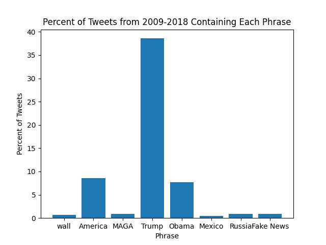

# [lab-web-data](https://csci40.rtealwitter.com/topics/05_web_scraping/lab.html)

| phrase            | percent of tweets |
| ----------------- | ----------------- |
|              wall | 00.68             |
|           america | 08.58             |
|              maga | 00.93             |
|             trump | 38.58             |
|             obama | 07.73             |
|            mexico | 00.45             |
|            russia | 00.91             |
|         fake news | 00.88             |

The table/ chart show the percent of tweets between 2009–2018 that mention each of the phrases. I expected the phrase "MAGA" to be the most common, but "Trump" was actually the most common (38.58%) 